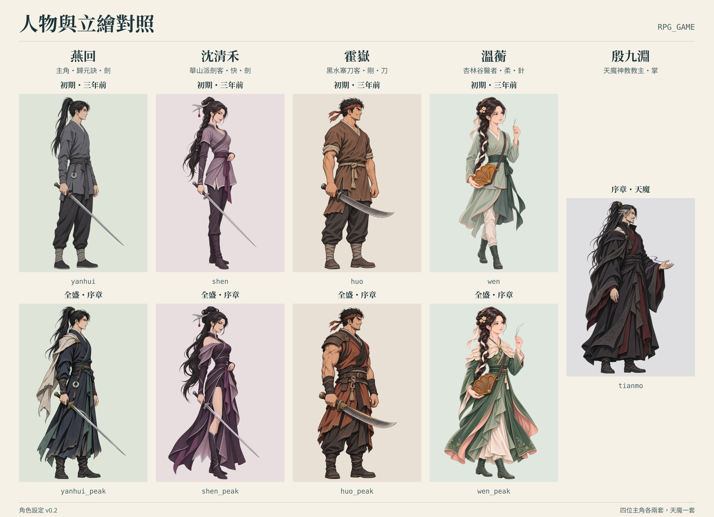

# 古風武俠 RPG（暫名）

韓式武林世界觀的古風武俠 RPG，畫風為動漫韓風，搭配古裝配樂。

前世，主角與三位同伴擊敗了天魔，卻為了護住同伴而同歸於盡。醒來時回到三年前：武功盡失，同伴還不認識他，而大戰三年後會如期而至。

以 Godot 4.7 開發，2D 橫向側視，戰鬥採半即時時間條、4 人小隊，結構為有三年期限的江湖自由探索。

## 目前狀態

**序章可以玩了，而且已經換上第一批美術。** 從標題畫面開始，八幕劇情與戰鬥交錯，一路到主角在三年前醒來。五個角色的立繪、天魔殿、介面外觀都是正式的圖；只有沈清禾的待機、出劍、受擊有動作，其他人與其他動作還是一張站姿，特效是程式畫的，最後一幕的舊居還沒有背景圖，也還沒有聲音。

2026-11-27 新增[批次 1 的戰鬥動作試做與介面](assets/incoming/batch_01/README.md)：沈清禾待機／出劍／受擊共 15 格、可在 Godot 編輯時間軸的場景，以及 7 個介面素材。Godot 4.7.1 的 31 項動畫檢查與實際 GPU 顯示擷取通過。**沈清禾的三段動作已經接進正式序章**（照 GPT 寫的節奏播放），但擁有者認為太生硬，已寫成更具體的[動作與特效規格](docs/animation_spec.md)請 GPT 重畫；大招出手前的人物特寫演出也做好了，等特寫圖。7 個介面素材還在 incoming，待接線。介面小圖示依擁有者要求取消，只留文字。

序章之後的內容（真正的戰鬥規則、探索、養成）還沒開始做。

## 怎麼玩

1. 到 Godot 官方網站下載 **Godot 4.7**（標準版，免費，解壓縮就能執行）。
2. 把這個倉庫下載到電腦上。
3. 開啟 Godot，按「匯入」，選倉庫裡的 `project.godot`。
4. 按 F5。

操作：滑鼠點擊。鍵盤的 Enter 或空白鍵可以推進對話、按下亮著的按鈕。右上角可以跳過序章。

五位人物的九套立繪已整理完成，姓名、初期與全盛造型可在[人物與立繪對照](assets/style/README.md)逐一查看。每套附全身、背面、臉部特寫與色票。天魔殿與戰鬥介面樣張收在[風格指南](assets/style/guide.md)。

[](assets/style/README.md)

## 文件

| 文件 | 內容 |
| --- | --- |
| [docs/direction.md](docs/direction.md) | 方向層級的決定、里程碑、風險 |
| [docs/design.md](docs/design.md) | 設計文件：世界觀、戰鬥、養成、門派、隊友、探索、資料格式、技術架構、GPT 的工作 |
| [docs/prologue.md](docs/prologue.md) | 序章劇本：每一幕的對白、出手順序、玩家操作 |
| [docs/art_requests.md](docs/art_requests.md) | 給 GPT 的補畫需求單：序章的畫面上還有哪些地方是程式暫代的，逐項標在截圖上，附檔名、尺寸與畫面要求 |
| [docs/animation_spec.md](docs/animation_spec.md) | 給 GPT 的動作與特效規格：普攻、小招、大招、受擊、特效、大招特寫各要畫幾張、每一張畫什麼、怎麼做、允收標準 |

## 分工

| 範圍 | 負責 |
| --- | --- |
| 遊戲邏輯、程式碼、資料結構、測試 | Claude |
| 美術、動畫 | GPT：每一張圖、每個動作的每一格與節奏（範圍與交付規格見 [設計文件第 15 章](docs/design.md#15-gpt-負責的工作)）。Claude 不改圖、不設計動作，只寫播放的程式 |
| 劇本大綱（起草）、台詞與遊戲內文字、音效 | Claude |
| 配樂 | Claude 從公開授權的音樂中挑選並接入；專案擁有者試聽定案 |
| 方向決策、劇本定案、試玩回饋、驗收 | 專案擁有者 |

美術與程式之間的介面是[動畫契約](docs/design.md#124-動畫契約)：每個角色提供同一組動畫名稱，照著檔名交付逐格圖，遊戲就會播那個動作；還沒交的動作繼續用靜態站姿頂替。

GPT 交付的檔案先放進 `assets/incoming/`；驗收通過後由 Claude 移到正式的資料夾並接進遊戲（[流程](docs/design.md#1510-交付與驗收)、[驗收紀錄](docs/design.md#1514-驗收紀錄)）。接下來要畫什麼，看[補畫需求單](docs/art_requests.md)。

## 專案結構

| 目錄 | 內容 |
| --- | --- |
| `core/` | 規則層：資料載入與驗證、劇本式戰鬥。不碰畫面，可以單獨測試 |
| `game/` | 全域單例：資料、文字、開發用參數 |
| `scenes/` | 畫面層：啟動畫面、戰鬥畫面與角色、對話框與面板 |
| `data/` | 內容資料：角色、招式、劇本、文字。改內容不必改程式 |
| `assets/` | 字型、角色（設定圖、站姿、頭像）、戰鬥背景、介面圖、風格指南；之後放音樂 |
| `tests/` | 自動測試 |
| `tools/` | 開發用工具：劇本比對、數值模擬、把設定圖整理成遊戲用的圖 |

想改序章的台詞：改 `data/text/zh_TW.json` 裡對應的句子，並同步改 `docs/prologue.md`。想改出手順序或氣血變化：改 `data/scripted/prologue_final.json`。

## 測試

在專案根目錄執行，`godot` 是 Godot 4.7 的執行檔。

```
# 剛下載、還沒用 Godot 編輯器開過專案的話，先讓引擎匯入圖檔（開過就不必）
godot --headless --path . --import

# 規則層的自動測試
godot --headless --path . -s res://tests/run_tests.gd

# 劇本文件與遊戲資料逐句比對
python3 tools/check_prologue.py

# 自動把序章從頭播到尾（模擬滑鼠點擊），並存下截圖
godot --path . -- --autoplay --input=clicks --shots=截圖資料夾
```

`tools/balance_sim.py` 是設計階段用來驗證戰鬥數值的模擬，執行方式見檔案開頭的說明。

`tools/art_needs.py` 從劇本與招式資料算出序章用到哪些圖、哪些還缺、哪些已交但沒過允收標準，加上 `--missing` 只列還沒好的。

`tools/check_frames.py` 照[動作規格](docs/animation_spec.md)的允收標準量逐格圖：張數、每張停的時間、相鄰兩張的跳動、腳底與大小、首尾銜接、出手點、特效的亮度、特寫的尺寸。不加參數是量遊戲裡的正式資料夾，加上資料夾路徑是量一批交付（例如 `python3 tools/check_frames.py assets/incoming/batch_02`）。張數與門檻在 `tools/anim_spec.json`。

`tools/prepare_art.py` 檢查角色設定圖的規格，並從設定圖產生遊戲用的站姿與頭像（需要 Python 的 Pillow 與 NumPy）。設定圖有更新、或想調整角色的高矮時重跑一次。

## 授權與素材來源

- 字型：Noto Serif TC，SIL Open Font License 1.1，見 `assets/fonts/`。
- 角色、背景、介面圖：由 GPT 以 ChatGPT 內建的圖像生成功能繪製、專案擁有者確認，提示詞收在 `assets/style/prompts.md`。


