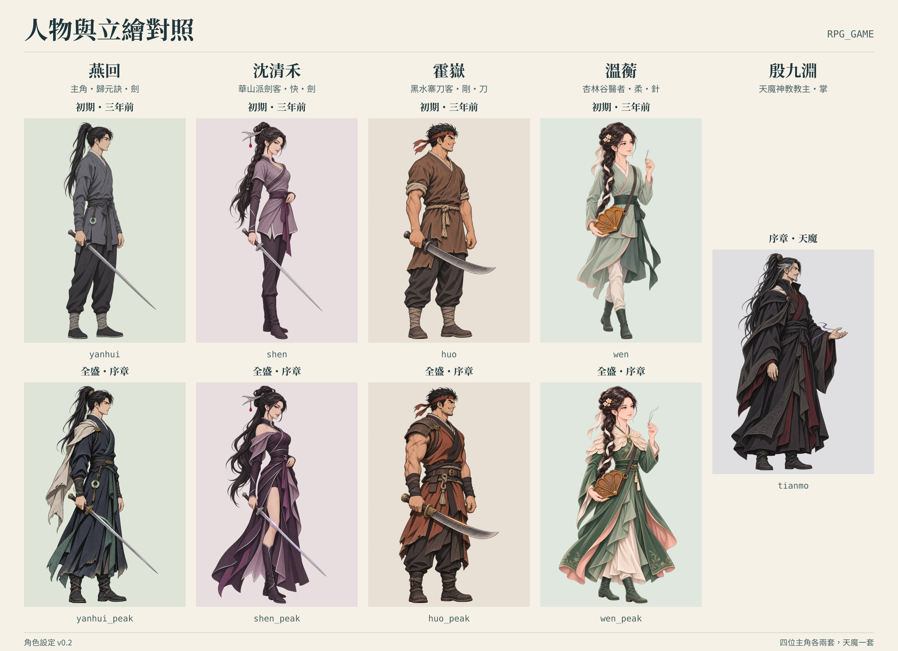
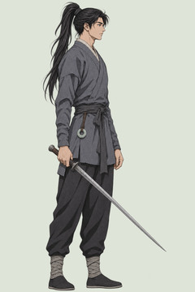
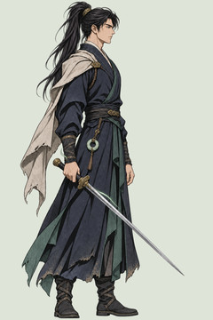
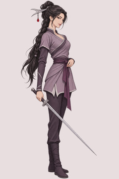
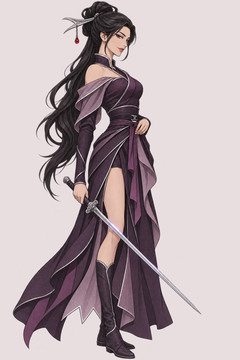
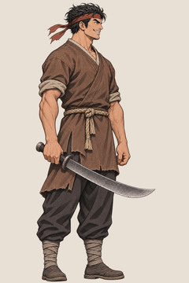
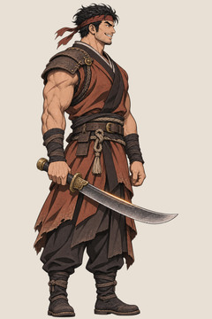
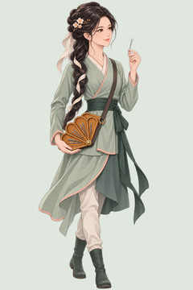
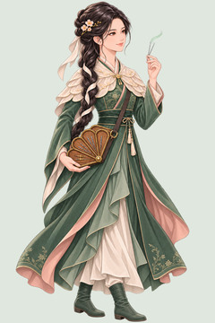
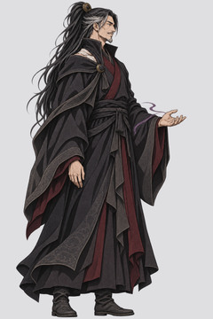

# 人物與立繪對照

四位主角各有初期與全盛造型，天魔殷九淵有一套，共五人、九套。初期對應重生後的三年前，全盛對應序章的最終戰。

點選下表的圖片可開啟 1024 × 1536 透明 PNG 原圖。沈清禾採用深梅衣裝與燕尾銀簪的新版，溫蘅採用清麗眉眼、杏花金釵與花瓣針匣的新版。

| 人物與身分 | 初期・三年前 | 全盛・序章 |
| --- | --- | --- |
| **燕回** 主角・歸元訣・劍 |  `yanhui` |  `yanhui_peak` |
| **沈清禾** 華山派劍客・快・劍 |  `shen` |  `shen_peak` |
| **霍嶽** 黑水寨刀客・剛・刀 |  `huo` |  `huo_peak` |
| **溫蘅** 杏林谷醫者・柔・針 |  `wen` |  `wen_peak` |
| **殷九淵** 天魔神教教主・掌 | — |  `tianmo` |

## 設定與交接

- [素材索引與配色](guide.md)列出九套造型各自的全身、背面、臉部特寫與色票，共 27 張角色原圖。
- [六頁角色設定冊](style/rpg_character_art_v02.pdf)收錄各角度、色碼與隊伍合成。
- [天魔殿隊伍預覽](style/tianmo_party_16_9.jpg)呈現四名同伴與天魔的靜態站位。

人物姓名對應專案的 `CHAR_YANHUI`、`CHAR_SHEN`、`CHAR_HUO`、`CHAR_WEN`、`CHAR_TIANMO`。序章造型識別碼與 `data/characters.json` 一致，初期造型沿用設計文件約定的識別碼。

本目錄交付角色設定原圖。遊戲內的動畫與表情立繪依[設計文件第 15 章](../../../docs/design.md#15-gpt-負責的工作)接續製作與驗收。素材收於 `assets/incoming/`，由其 `.gdignore` 排除自動匯入，接入遊戲依既有交接流程執行。
