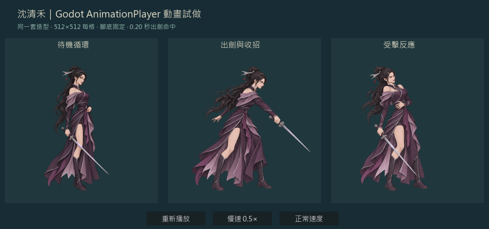
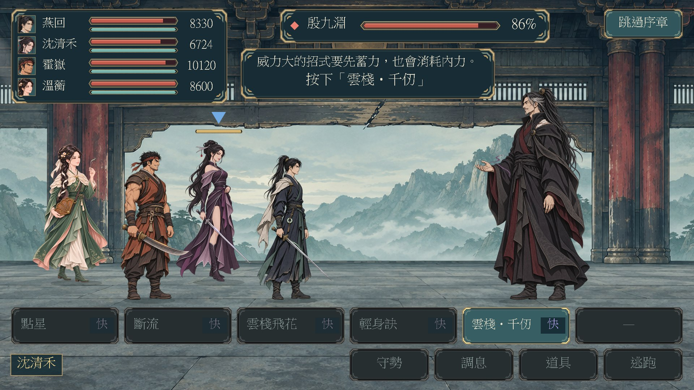

# 批次 1：角色戰鬥動作試做與介面

2026-11-27 依擁有者指示：先補角色戰鬥動作；小圖示取消、保留文字；素材直接提交 `a26222239-sketch/RPG_GAME`。

本批已完成 **沈清禾三段動畫試做＋7 個介面素材**，待 Claude 接進正式序章與美術驗收。其他角色與沈清禾其餘動作尚未完成。

## 先看 Godot 動畫



在 Godot 開啟 `preview/godot_project/project.godot`：

- F5：同時播放待機、出劍、受擊；可重新播放或切換半速。
- 開啟 `shen_actor.tscn`，選取 AnimationPlayer，即可檢視與調整 idle、attack_light、hit 的時間軸。
- 這是獨立試做專案，主遊戲的正式序章仍由 Claude 接入。

| 動作 | 交付 PNG | 格數 | 播放 |
| --- | --- | --- | --- |
| 待機 | `characters/shen_peak/frames/idle.png` | 6 | 1.2 秒循環，沿正式站姿微量呼吸 |
| 出劍 | `characters/shen_peak/frames/attack_light.png` | 6 | 0.55 秒；第 3 格（從 0 起算）、0.20 秒命中 |
| 受擊 | `characters/shen_peak/frames/hit.png` | 3 | 0.32 秒；第 1 格呈現受擊 |

每格 512×512、透明 PNG、朝右，腳底中點基準 (256,480)。站立基準高 392 px。四張新關鍵姿勢保留深梅衣裝、燕尾銀簪、紅墜與原本的劍；完整原稿在 `characters/shen_peak/source/`。

**試做限制：** 15 格包含停留及重用格，出劍蓄勢的第 1／2 格相同，起訖重用原站姿；受擊亦回到原站姿。這是關鍵姿勢加停留的初版，尚未補成連續的細緻中間動作，也不是全角色動畫已完成。

## Claude 動畫接入

`meta.json` 有格數、每格時間、循環、命中格與命中時間。`animations.tres` 是 AnimationLibrary；`preview_atlas.png` 為同一組 15 格的合併圖。原始三條橫排 PNG 仍遵守需求單，可由程式各自讀取。

Godot 試做場景採 Node2D → Visual → Sprite，AnimationPlayer 的軌道是 `Visual/Sprite:frame`。目前正式 BattleActor 的視覺節點由程式建立、未使用這套名稱，因此接入時請明確設定節點／軌道路徑及來源圖，不可只放入 AnimationPlayer 就當作接線完成。用動畫視覺取代原站姿顯示，避免兩層重疊；其餘動作保留既有 fallback。非循環動畫結束後回待機。

本批不修改戰鬥規則、劇本或正式序章的角色程式。

## 戰鬥介面：7 個接入檔



| 檔案 | 尺寸 | 接法 |
| --- | --- | --- |
| `ui/button_disabled.png` | 320×128 | 停用；九宮格四邊 28 px |
| `ui/button_pressed.png` | 320×128 | 按下；九宮格四邊 28 px |
| `ui/button_active.png` | 320×128 | 可操作；九宮格四邊 28 px |
| `ui/mp_track.png` / `mp_fill.png` | 各 384×20 | 內力；左右端頭各 20 px |
| `ui/gauge_track.png` / `gauge_fill.png` | 各 384×20 | 行動／蓄招；左右端頭各 20 px |

三張按鈕 alpha 與原按鈕逐像素相同。新圖已有明暗狀態，接入時使用白色 modulation，避免再疊舊的停用調暗與 1.45 倍脈動。

內力為霧玉青 #7BB9B0；行動／蓄招為舊金 #D9B872。底槽與填色同尺寸、左上對齊，填色左右空白各 10 px；0 值隱藏填色，端頭不拉伸。

六個小圖示已取消。勁路只用「剛／柔／快」文字，狀態只用「守勢／破綻／遲緩」文字。接入時也移除原招式標籤的程式 Glyph，文字置中。戰鬥介面圖為合成預覽，並非正式序章引擎截圖。

## 驗證與重建

- Godot 4.7.1：31 項動畫檢查通過，包含時間軸幀值、15 格尺寸、透明度、每格腳底 y=479 與待機循環；結果在 `characters/shen_peak/frames/godot_test_results.json`。
- OpenGL／RTX 5060 Laptop 實際渲染成功；上方 Godot 圖為 1280×600 引擎擷取。
- 7 個介面素材的尺寸、透明邊緣與 SHA256 檢查通過；沿用前一版相同像素。
- 受限執行環境不能寫入 AppData：首次預設日誌啟動失敗，改用明確的工作目錄 log 後完成測試；編輯器與 GPU 日誌仍有設定／快取目錄寫入錯誤，素材匯入、31 項播放檢查與擷取均完成。未將這些錯誤記成首輪無錯誤。

在完整倉庫下執行：

```
godot --headless --path assets/incoming/batch_01/preview/godot_project --script res://../../source/build_shen.gd
godot --headless --editor --import --path assets/incoming/batch_01/preview/godot_project
godot --headless --path assets/incoming/batch_01/preview/godot_project -- --test
```

第一行的 script 可改用絕對路徑，避免不同 shell 對相對路徑的解讀；受限環境另指定可寫入的 `--log-file`。介面素材用 `source/rebuild.ps1` 重建，生成稿已附。來源與製作程式隨本批保存。

下一輪依需求單補殷九淵、燕回、霍嶽、溫蘅的動作，以及沈清禾其餘招式；先在正式序章驗收這三段，確認接口與播放節奏。

