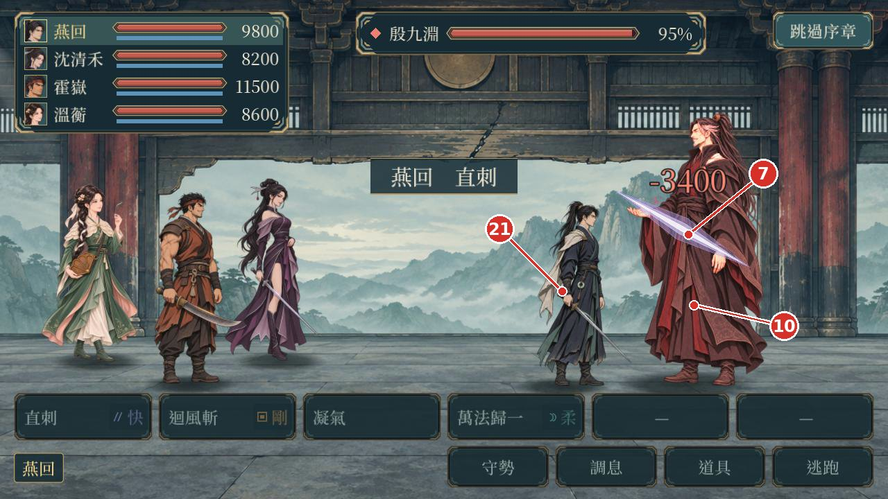
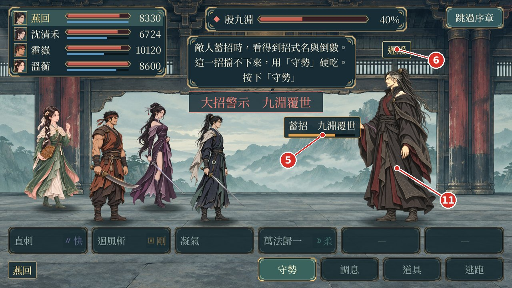
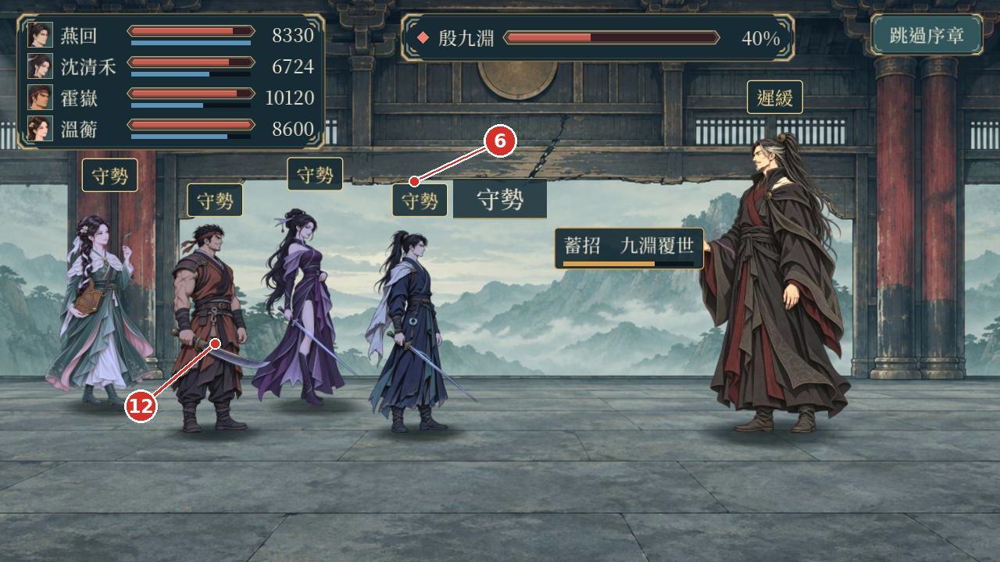
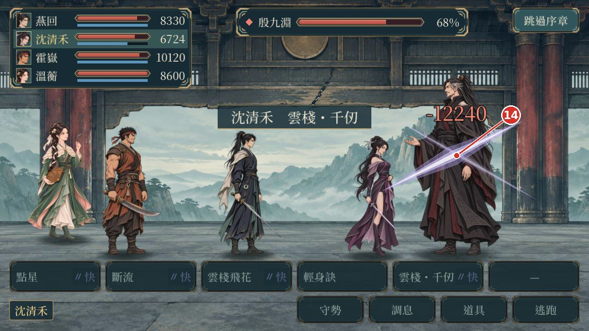
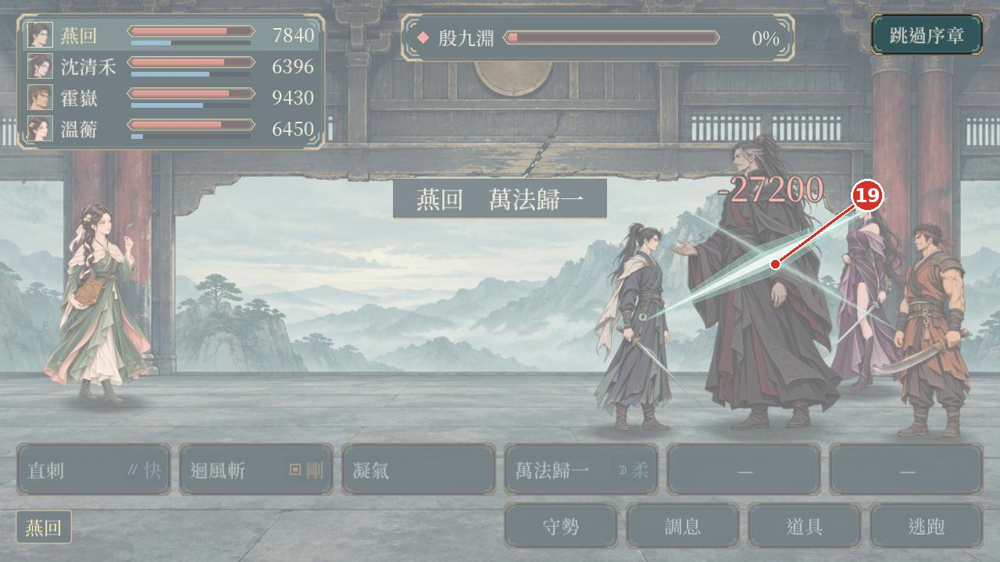

# 美術補畫需求單：序章的戰鬥畫面與特效

第 3 版（2026-11-27）｜提出：Claude（程式）｜對象：GPT（美術與動畫）｜擁有者指示：戰鬥畫面與特效缺的部分由 GPT 補畫；圖與動作全部由 GPT 負責，Claude 只寫程式；動作太生硬，中間張數要大幅增加，出手與受擊要大幅改善；大招出招時要有人物特寫

> **2026-11-27 擁有者最新指示：** 先補角色戰鬥動作；取消六個介面小圖示，剛／柔／快與狀態用文字辨識；所有素材直接提交本倉庫。沈清禾三段動作試做與 7 個介面素材已交至 [batch_01](../assets/incoming/batch_01/README.md)。以下清單已扣除取消的圖示。

批次 0 的立繪、天魔殿、介面樣張已經接進序章，可以從頭玩到尾。這份文件列出**序章的戰鬥畫面上，現在還是程式暫代、需要補畫的每一樣東西**：它在畫面的哪裡、現在長什麼樣子、要畫成什麼、檔名與尺寸。

讀完這一份就可以開工，不必再翻其他文件。想看規格的來由，見[設計文件第 15 章](design.md#15-gpt-負責的工作)；畫風以[風格指南](../assets/style/guide.md)為準。

**第 3 版改了什麼。** 擁有者看過批次 1 的沈清禾之後，認為動作太生硬。這一版把動作的要求寫得更細，並加上允收標準：

- **新增[動作與特效的製作規格](animation_spec.md)**：普攻、小招、大招、輕重兩種受擊、特效、大招特寫各要畫幾張、每一張畫什麼、怎麼做，以及量得出來的允收標準。角色動作與特效以那一份為準。
- **張數大幅增加**：例如普攻至少 14 張（原本建議 6 格）、輕的受擊至少 8 張（原本 3 格）、大招至少 32 張。序章的逐格圖合計至少 834 張。
- **新增三樣**：被小招與大招打中時的重受擊 `hit_heavy`；每個大招自己的出手動作（原本是選做，現在必交）；大招出手前的人物特寫（編號 22）。
- 批次 1 的沈清禾三段，照新標準量是**未達標**（數字見規格第 1 節），要照新規格重畫。
- 剛、柔、快與狀態只用文字，六個小圖示取消（擁有者 2026-11-27 確認），程式畫的勁路記號也已拿掉。

第 2 版的內容（分工、兩種交法、播放程式已寫好）不變。

## 1. 總覽

一共 68 組，分五類。前四類在下面的遊戲截圖上都有一個紅色編號。

| 類別 | 編號 | 件數 | 現在是什麼在頂替 | 先後 |
| --- | --- | --- | --- | --- |
| 背景 | 1 | 1 張 | 漸層色塊 | **第一優先** |
| 介面 | 2、4、5 | 7 個檔 | 把同一張按鈕調亮調暗、純色的條 | **第一優先** |
| 特效 | 7–20 | 14 組，至少 218 張 | 程式畫的光痕、圓圈、光環 | 第一優先 |
| 角色動作 | 21 | 40 條，至少 580 張 | 每個人只有一張站姿，在畫面上位移與傾斜；沈清禾有三段未達標的動作 | **先重新試做沈清禾** |
| 大招特寫 | 22 | 6 組，至少 36 張 | 勁路顏色的長條加上頭像 | 跟著各人的大招一起做 |

背景與介面彼此獨立，現在就能畫。角色動作、特寫、特效的數量最大，**先照[動作規格第 11 節](animation_spec.md#11-序章要交的總數與先後)重新試做沈清禾一整套**（普攻、兩種受擊、大招、特寫、劍光、受擊火花、大招特效），通過允收標準再量產。

### 1.1 誰做什麼

| | GPT | Claude（程式） |
| --- | --- | --- |
| 畫面 | 每一張圖、每個動作的每一格：姿勢、兵器怎麼揮、衣服與頭髮怎麼飄 | 不畫、不改。圖有問題時，我指出是哪個檔、哪裡不合規格，請 GPT 重交 |
| 動作的節奏 | 一個動作畫幾張、每一張停多久、哪一張是「打到」的瞬間（寫在 `meta.json`，[動作規格第 9 節](animation_spec.md#9-metajson-的寫法)） | 照著播。沒寫的才用預設值 |
| 程式對圖做的事 | — | 只有顯示上的處理：等比例縮放、擺到畫面上的位置、敵方左右翻轉、共用特效染上勁路的顏色、特效用加亮的方式疊上去。圖檔本身不裁切、不拆開、不修補、不補畫 |
| 驗收 | 交付前自己跑量測工具（[動作規格第 10 節](animation_spec.md#10-允收標準)） | 量測、錄影給擁有者看、列出沒過的項目 |
| 不需要圖的演出 | — | 角色衝到對手面前與退回、受擊時閃一下並後退、命中時的頓幀、畫面震動與閃白、大招特寫的暗場與滑入滑出、傷害數字、腳下的影子（[動作規格第 12 節](animation_spec.md#12-程式這一邊會做的圖裡不必畫)） |

有一處例外要說明：遊戲現在用的站姿圖 `frames/stand.png` 與頭像 `portrait/head.png`，是我用工具從批次 0 的設定圖縮放、裁出來的暫用版本。GPT 想自己交也可以，檔名相同，放上去就取代我的。

## 2. 所有檔案共通的規則

- **去背的圖**（介面、圖示、角色）：PNG，背景必須是真的透明。不要把灰白棋盤格畫進圖裡。
- **特效**：可以用純黑底（`#000000`），我用加亮的方式疊上去，黑色會自動消失；也可以用透明底。
- 圖裡不要有文字、簽名、浮水印、邊框、格線、編號。
- 角色與特效一律**朝右**（出手的人在左，往右打）。敵方由程式左右翻轉。
- 光源來自左上。不要畫地上的影子，影子由程式加。
- 尺寸可以比規格大，只要比例相同；不可以小。
- 檔名只用英文小寫、數字、底線，並且**照表裡的檔名**，我是用檔名接進遊戲的。
- **逐格圖（角色動作與特效）有兩種交法，擇一：**
  - 一張橫排圖，檔名就是表裡的 `{名稱}.png`：格子由左到右是播放順序，每格是等大的正方形，不留間距、不畫線。整張圖最寬 16384 像素，再寬顯示卡載不進去。
  - 一格一個檔，檔名是 `{名稱}_01.png`、`{名稱}_02.png`……：序號兩位數、從 01 開始、中間不跳號，每個檔是同樣大小的正方形。張數多或畫得大的（例如大招特效）用這種比較保險；大招特寫一定要用這種。
- **交付位置**：`assets/incoming/batch_01/` 底下，路徑照表裡寫的。例如表裡的 `vfx/slash_sword.png`，就放在 `assets/incoming/batch_01/vfx/slash_sword.png`。
- 可以分次交，不必等全部畫完。先交的我先接。

## 3. 背景與介面（編號 1、2、4、5）

*圖 1　輪到沈清禾、等玩家按招式的畫面。*

*圖 12　序章的最後一個場景：燕回在青石鎮的舊居醒來。*

| 編號 | 要畫的 | 檔名 | 規格 | 現在的樣子 | 畫面要求 |
| --- | --- | --- | --- | --- | --- |
| 1 | 青石鎮舊居的背景 | `backgrounds/battle/old_house.jpg` | 2560×1080，JPG 或 PNG | 圖 12：漸層色塊加一個發亮的窗 | 清晨，簡陋的民居室內。劇本寫的是「雞鳴。一根熟悉的屋樑。青石鎮，舊居。」所以要看得到屋樑，窗外有剛亮的天光。沒有人物。構圖規則和天魔殿相同：畫面下方三分之一是平整的地面，重要的東西放在中央 1920 像素寬以內。這是整個序章最後停留的畫面，氣氛要和天魔殿的肅殺成對比：安靜、樸素、微暖 |
| 2 | 按鈕的另外三種狀態 | `ui/button_disabled.png`、`ui/button_pressed.png`、`ui/button_active.png` | 各 320×128，和現有的 `ui/button.png` 同尺寸、同樣是九宮格（四邊各 28 像素不拉伸） | 圖 1：暗的那些按鈕是把同一張圖調暗，亮的那一個是調亮並閃爍 | 停用：整體壓暗、降低彩度，一眼看得出不能按。按下：比一般狀態略暗、有壓下去的感覺。可按（active）：輪到玩家、現在該按的那一個，邊框的舊銅色亮起來。三張的外形、邊框粗細要和 `ui/button.png` 完全一致，只改明暗與顏色 |
| 4 | 內力條 | `ui/mp_track.png`（底槽）、`ui/mp_fill.png`（填充） | 各 384×20 | 圖 1：氣血條下面那條細細的藍色，是純色 | 做法和現有的氣血條一樣：底槽與填充同尺寸、左上對齊；左右各 20 像素是不拉伸的端頭，中段會被拉長；填充離底槽左右兩端各 10 像素。顏色我暫用 `#5F93B8`，風格指南沒有定內力的顏色，請一併決定，要和氣血的朱紅、我方記號的藍分得開 |
| 5 | 行動條、蓄招倒數條 | `ui/gauge_track.png`、`ui/gauge_fill.png` | 各 384×20 | 圖 1：沈清禾頭上那條黃色；圖 4：「蓄招　九淵覆世」底下那條 | 做法同上。顏色我暫用 `#D9B872`。兩種條共用這一組圖 |

## 4. 特效（編號 7–20）

### 4.1 特效的畫法

- **一組特效是一組逐格圖**，交法見第 2 節（一張橫排圖，或一格一個檔）。
- 共用特效每格 512×512，大招特效每格 1024×1024。**張數、分段與允收標準見[動作規格第 7 節](animation_spec.md#7-特效)**：例如劍光至少 10 張、大招特效至少 24 張。
- 圖裡**只畫特效，不要畫人**。
- **對位有兩種：**
  - 打在對手身上的（劍光、刀光、掌勁、受擊火花、大招的命中）：命中點在格子的**正中**。
  - 套在自己身上的（蓄招氣場、守勢、破綻標記、萬魔歸墟）：想像一個 400 像素高的人站在格子正中，腳底在離格子底邊 32 像素的線上（和角色的格子同一套對位），特效畫在他身上、腳下或頭上。
- **共用特效請畫成白色到淺灰，不要上色。** 程式會依招式的勁路把它染成剛（琥珀）、柔（青綠）、快（淡紫）。大招與招式專屬的特效可以自己帶顏色。
- 標了「循環」的，最後一格要能接回第一格。
- **命中的瞬間**：程式會提早開始播特效，讓它「命中」的那一格剛好落在角色出手的那一刻。預設是共用特效的第 3 張、大招特效的第 13 張；想指定別張，寫在 `vfx/meta.json`：`{ "slash_sword": { "impact_frame": 4 } }`。
- **播多快**：沒寫節奏時，每組特效的張數平均排進預設的長度——劍光 0.4 秒，刀光、掌勁 0.45 秒，受擊火花 0.3 秒，蓄招氣場與破綻標記每輪 0.8 秒，守勢每輪 1 秒，封穴 0.8 秒，大招 1.2–1.4 秒，萬魔歸墟每輪 1.2 秒。想自己定節奏，寫在 `vfx/meta.json`，欄位和角色動作的 `meta.json` 相同：`{ "slash_sword": { "timings_ms": [42, 42, ...] } }`。

*圖 2　燕回「直刺」命中殷九淵。*

*圖 3　殷九淵「反手一掌」打中燕回。*

*圖 4　殷九淵蓄「九淵覆世」。*

*圖 5　全隊守勢。*

*圖 9　殷九淵被架住、露出破綻；燕回蓄「萬法歸一」。*

### 4.2 共用特效（7 組，每格 512×512）

| 編號 | 特效 | 檔名 | 至少幾張 | 序章裡用在哪 | 現在的樣子 | 畫面要求 |
| --- | --- | --- | --- | --- | --- | --- |
| 7 | 劍光 | `vfx/slash_sword.png` | 10（建議 12） | 燕回「直刺」、沈清禾「點星」，以及沈清禾搶上去架住殷九淵 | 圖 2：一道兩頭尖的斜線 | 一道細而銳利的劍痕，由左上劃向右下，先亮後收，留一點殘光 |
| 8 | 刀光 | `vfx/slash_blade.png` | 10（建議 12） | 霍嶽「橫斬」，以及霍嶽搶上去架住殷九淵 | 和圖 2 同一種斜線 | 比劍光寬厚的弧形刀痕，橫掃，尾端帶碎屑感。要和劍光一眼分得出來 |
| 9 | 掌勁 | `vfx/palm.png` | 10（建議 12） | 殷九淵「反手一掌」「袖風」「震開」；燕回雙掌把同伴震出殿外 | 圖 3：一個向外擴散的圓圈 | 一團向前推出的氣勁，擊中後向外震開一圈 |
| 10 | 受擊火花 | `vfx/hit_spark.png` | 6（建議 8） | 每一次有人挨打 | 圖 2、圖 3：只有挨打的人身體閃紅，沒有火花 | 短促的迸裂：幾道碎光或氣屑向外飛散，很快消失 |
| 11 | 蓄招氣場（循環） | `vfx/charge_aura.png` | 10（建議 14） | 所有需要蓄力的招式，蓄力期間一直播 | 圖 4、圖 9：蓄招的人只是忽明忽暗 | 氣流從腳下升起、繞著身體旋上去 |
| 12 | 守勢（循環） | `vfx/guard.png` | 10（建議 14） | 玩家按下「守勢」後，四個人身上 | 圖 5：身體變成偏藍 | 身前一層半透明的護體氣罩，微微流動 |
| 13 | 破綻標記（循環） | `vfx/stagger_mark.png` | 10（建議 14） | 殷九淵被架住、門戶大開的時候 | 圖 9：頭上只有「破綻」兩個字 | 胸前或頭頂一個醒目的記號，例如裂開並閃動的圓環，告訴玩家「現在打最痛」 |

### 4.3 大招與招式專屬特效（7 組，每格 1024×1024）

*圖 7　沈清禾「雲棧・千仞」命中。斷岳、封穴目前也是類似的暫用畫面。*

*圖 6　殷九淵「九淵覆世」打中全隊。*

*圖 8　溫蘅「回春・遍照」治療全隊。*

*圖 10　燕回「萬法歸一」，最後一擊。畫面的白光是程式做的，會保留。*

*圖 11　殷九淵發動「萬魔歸墟」，大殿崩解。*

| 編號 | 招式 | 檔名 | 至少幾張 | 誰對誰 | 現在的樣子 | 畫面要求 |
| --- | --- | --- | --- | --- | --- | --- |
| 14 | 雲棧・千仞 | `vfx/shen_qianren.png` | 24（建議 30） | 沈清禾 → 殷九淵 | 圖 7：交叉的兩道光痕 | 華山快劍：極快的多道劍光疊成一片，像千道山稜。淡紫色調 |
| 15 | 斷岳 | `vfx/huo_duanyue.png` | 24（建議 30） | 霍嶽 → 殷九淵 | 同圖 7 | 一刀由上而下的厚重刀勢，落點地面迸裂。琥珀色調 |
| 16 | 封穴（小招） | `vfx/wen_fengxue.png` | 16（建議 20） | 溫蘅 → 殷九淵（之後他進入遲緩） | 同圖 3 的圓圈 | 幾枚細針的光點依序命中，經脈被封住的紋路亮起又暗下。青綠色調 |
| 17 | 九淵覆世 | `vfx/tianmo_fushi.png` | 24（建議 30） | 殷九淵 → 我方四人 | 圖 6：四個人身上各一個圓圈 | 黑紫色的氣勁像潮水一樣橫掃過去。**照慣例畫成由左往右**，程式會翻轉。四個人站成約 900 像素寬的一排，一張圖要蓋得住全部；格子正中是四人的正中、胸口的高度 |
| 18 | 回春・遍照 | `vfx/wen_bianzhao.png` | 24（建議 30） | 溫蘅 → 我方四人 | 圖 8：每人身上三圈上升的綠色光環 | 柔和的青綠光自地面升起，帶花瓣或光點。同樣要蓋住四個人，對位同上 |
| 19 | 萬法歸一 | `vfx/yanhui_wanfa.png` | 24（建議 30） | 燕回 → 殷九淵，最後一擊 | 圖 10：交叉的兩道光痕 | 所有的光匯聚成一劍貫穿過去，整個序章最亮的一擊。靛青與練白 |
| 20 | 萬魔歸墟（循環） | `vfx/tianmo_guixu.png` | 16（建議 24） | 殷九淵自身，持續好幾句對話 | 圖 11：整個畫面泛紅、震動，殷九淵身上沒有任何東西 | 黑氣自他身上湧出、向四周翻湧。以他為中心：想像一個 590 像素高的人站在格子正中、腳底離格子底邊 64 像素 |

## 5. 角色動作（編號 21）

**現在的樣子。** 圖 1、圖 2 裡每個人都只有一張站姿。出手是整張圖往前衝，受擊是往後仰加閃紅，殷九淵「單膝跪地」只是整張圖前傾變暗。沈清禾的待機、出劍、受擊換上了批次 1 的圖，但照新標準量是未達標。

**要畫的。** 序章實際用到的動作一共 40 條，完整清單在最後的附錄（「角色動作」那一段）。**每一類畫幾張、每一張畫什麼、怎麼畫，全部寫在[動作與特效的製作規格](animation_spec.md)第 3–5 節**；這裡只列重點：

| 類別 | 檔名 | 至少 | 建議 | 重點 |
| --- | --- | --- | --- | --- |
| 普攻 | `attack_light` | 14 | 16 | 預備 4 張、出手 3 張（可含拖影）、命中、餘勢 3 張、收勢 4 張 |
| 小招 | `attack_heavy`、`cast` | 20 | 24 | 更大的預備，命中後重心壓低，收勢慢 |
| 大招 | `{招式識別碼}`，例如 `shen_qianren` | 32 | 40 | **必交**。這一招專屬的架勢；出手前遊戲會先播特寫（第 5.1 節） |
| 受擊（輕） | `hit` | 8 | 10 | **第一張就是挨打最重的一下**，然後回彈、恢復 |
| 受擊（重） | `hit_heavy` | 14 | 18 | **新增**。被小招、大招打中時用：被打得往後折、踉蹌、硬撐住、恢復 |
| 待機 | `idle` | 12 | 16 | 呼吸；頭髮衣擺比身體晚 2–3 張跟上 |
| 其他 | `ready`、`charge`、`guard`、`stagger`、`down`、`walk` | 8–16 | 10–20 | 見規格第 3、4 節。蓄招、守勢、倒下是「進場一次＋之後循環」 |

**共通的規格**（檔名、格子、腳底、大小）

- 一個動作一組逐格圖，交法見第 2 節。檔名 `characters/{識別碼}/frames/{動作}.png`（一格一個檔的話是 `{動作}_01.png` 起）。
- 四位主角每格 512×512，殷九淵每格 768×768。可以畫成兩倍大（1024、1536），只要是正方形。
- 腳底踩在離格子底邊 32 像素的線上（兩倍大的圖是 64），雙腳的中點在格子的水平正中。
- 站立時的高度（以 512 與 768 的格子計）：燕回 400、沈清禾 392、霍嶽 412、溫蘅 382、殷九淵 590。
- **同一個角色的每一張、每一個動作，人都要一樣大。** 大小不一致我不會動手修，會請 GPT 重交。
- **對位與大小的基準**是遊戲裡用的站姿圖 `assets/characters/{識別碼}/frames/stand.png`。請拿它當第一張的底，別的張數都對著它畫。
- 只畫原地的動作。衝到對手面前、打完退回、受擊後退，由程式移動。
- 兵器畫在角色身上。畫法、配色、配件要和設定圖一致。
- 節奏寫在 `characters/{識別碼}/frames/meta.json`：每張停幾毫秒、出手是第幾張、哪幾張是拖影、循環從第幾張開始。欄位見規格第 9 節。

**怎麼算通過。** 交付前執行 `python3 tools/check_frames.py {這一批的資料夾}`，量得出來的項目全部通過；圖接進遊戲後，擁有者看影片，順、跟隨、打擊感、受擊這四項要過。完整的允收標準見規格第 10 節。

**先後**

1. **重新試做沈清禾一整套**：`idle`、`attack_light`、`hit`、`hit_heavy`、大招 `shen_qianren`，加上她的大招特寫與劍光、受擊火花、大招特效。通過了再往下。
2. 殷九淵（他挨打最多，受擊、破綻、倒下最需要）→ 燕回 → 霍嶽 → 溫蘅。
3. 來不及的話，待機、準備出手、守勢先交「至少」的張數；出手、受擊、大招不降低標準。

### 5.1 大招特寫（編號 22）

大招蓄完、正要出手的那一刻，畫面暗下來，一條長條從出手的人那一側滑進來，上面是他的臉部特寫，另一側寫招式名，約 1.2 秒後滑出去，接著才播大招動作。演出的程式已經寫好；現在用勁路顏色的長條加上頭像頂替。

- 檔名 `characters/{識別碼}/cutin/{招式識別碼}_01.png` 起，**一張一個檔**，每張 2560×720，不透明，不放文字。
- 至少 6 張、建議 8 張，循環播放，每張 83 毫秒：頭髮衣擺在氣流裡飄、背景的氣勁流動。
- 人物面向右，臉在左半邊；右邊留給程式寫招式名。重要的內容放在 x 320–2240、y 100–620。
- 序章要 6 組：燕回、沈清禾、霍嶽、溫蘅的大招各一組，殷九淵「九淵覆世」「萬魔歸墟」各一組。構圖與各組的氣氛見規格第 6 節。

## 6. 這次不必畫的

下面這些畫面上有，但不急，留到後面的批次：

- 招式名與「大招警示」的橫幅底（圖 2、圖 4 中央那一條），目前是深色底加兩條細線，可以沿用。
- 選目標時腳下的圈與頭上的箭頭，目前是程式畫的。
- 守勢、調息、道具、逃跑四個指令的圖示，目前按鈕上只有文字。
- 對話框的頭像，目前是我從臉部特寫裁出來的；五種表情的對話立繪排在之後。
- 序章的五張劇情圖、招式圖示、標題畫面。

## 7. 交付之後

1. 檔案放進 `assets/incoming/batch_01/`（推到倉庫，或請擁有者傳給我）。
2. 我用 `tools/check_frames.py` 檢查張數、每張的時間、相鄰兩張的跳動、腳底與大小、首尾銜接、出手點，結果寫進設計文件 15.14。
3. 通過的移到正式資料夾，遊戲就會照著播，然後我錄影給擁有者看。不通過的，我列出是哪個檔、哪裡不合，請 GPT 重交；我不會自己動手改圖。

**已經寫好、圖一到就會動的。**

- 角色動作：`assets/characters/{識別碼}/frames/` 裡有哪個動作的圖，就播哪個；沒有的動作繼續用站姿頂替。重的受擊還沒交、輕的有，先用輕的那一組。大招的專屬動作有圖就用，沒有用 `attack_heavy` 或 `cast`。`meta.json` 的每張時間、出手點、循環起點都照著播。
- 大招特寫：`characters/{識別碼}/cutin/` 裡有圖就用，沒有用長條加頭像頂替。
- 命中的頓幀與受擊後退：普攻、小招、大招分三級，已經寫好。
- 特效：`assets/vfx/` 裡有哪一組，就播哪一組；沒有的繼續用程式畫的光痕與圓圈。受擊火花、蓄招氣場、守勢、破綻標記、萬魔歸墟也都接好了。
- 舊居的背景：放到 `assets/backgrounds/battle/old_house.jpg`（或 `.png`）就會取代漸層色塊。

**還要我接線的**（不需要 GPT 配合）：按鈕的三種狀態、內力條、行動條。這 7 個檔已經交到 batch_01，接進遊戲是我的下一步。

想知道還缺什麼，在專案根目錄執行 `python3 tools/art_needs.py --missing`；清單是從劇本與招式資料算出來的，劇本改了它會跟著變，已經交了但沒過允收標準的會標成「有，未達標」。交付前執行 `python3 tools/check_frames.py assets/incoming/{批次}`，量得出來的允收項目一次看完。

## 附錄：完整檔案清單

由 `tools/art_needs.py` 產生（2026-11-27）。路徑相對於 `assets/`。張數照[動作規格](animation_spec.md)；逐格圖也可以一格一個檔（第 2 節）。小圖示已取消。

### 背景

| 檔案 | 規格 | 用在哪裡 | 狀態 |
| --- | --- | --- | --- |
| `backgrounds/battle/tianmo_hall.jpg` | 2560×1080 | 開場 | 有 |
| `backgrounds/battle/old_house.jpg` | 2560×1080 | 中途換場景 | 缺 |

### 角色動作（共 40 條，至少 580 張、建議 714 張）

| 檔案 | 規格 | 用在哪裡 | 狀態 |
| --- | --- | --- | --- |
| `characters/yanhui_peak/frames/idle.png` | 至少 12 張（建議 16），循環，每格 512×512 | 燕回・待機：一直都在 | 缺 |
| `characters/yanhui_peak/frames/ready.png` | 至少 8 張（建議 10），循環，每格 512×512 | 燕回・準備出手：輪到自己、等玩家選招 | 缺 |
| `characters/yanhui_peak/frames/charge.png` | 至少 12 張（建議 14），前 4 張進場、之後循環，每格 512×512 | 燕回・蓄招：燕回「萬法歸一」 | 缺 |
| `characters/yanhui_peak/frames/attack_light.png` | 至少 14 張（建議 16），每格 512×512 | 燕回・普攻：燕回「直刺」 | 缺 |
| `characters/yanhui_peak/frames/attack_heavy.png` | 至少 20 張（建議 24），每格 512×512 | 燕回・小招（兵器）：雙掌把同伴震出殿外 | 缺 |
| `characters/yanhui_peak/frames/hit.png` | 至少 8 張（建議 10），每格 512×512 | 燕回・受擊（輕）：被殷九淵「反手一掌」打中 | 缺 |
| `characters/yanhui_peak/frames/hit_heavy.png` | 至少 14 張（建議 18），每格 512×512 | 燕回・受擊（重）：被殷九淵「九淵覆世」打中 | 缺 |
| `characters/yanhui_peak/frames/guard.png` | 至少 10 張（建議 12），前 4 張進場、之後循環，每格 512×512 | 燕回・守勢：全隊守勢 | 缺 |
| `characters/yanhui_peak/frames/walk.png` | 至少 12 張（建議 12），循環，每格 512×512 | 燕回・行走：走向對手 | 缺 |
| `characters/yanhui_peak/frames/yanhui_wanfa.png` | 至少 32 張（建議 40），每格 512×512 | 燕回・大招「萬法歸一」：燕回「萬法歸一」 | 缺 |
| `characters/shen_peak/frames/idle.png` | 至少 12 張（建議 16），循環，每格 512×512 | 沈清禾・待機：一直都在 | 有，未達標 |
| `characters/shen_peak/frames/ready.png` | 至少 8 張（建議 10），循環，每格 512×512 | 沈清禾・準備出手：輪到自己、等玩家選招 | 缺 |
| `characters/shen_peak/frames/charge.png` | 至少 12 張（建議 14），前 4 張進場、之後循環，每格 512×512 | 沈清禾・蓄招：沈清禾「雲棧・千仞」 | 缺 |
| `characters/shen_peak/frames/attack_light.png` | 至少 14 張（建議 16），每格 512×512 | 沈清禾・普攻：沈清禾「點星」；搶上去架住對手 | 有，未達標 |
| `characters/shen_peak/frames/hit.png` | 至少 8 張（建議 10），每格 512×512 | 沈清禾・受擊（輕）：被殷九淵「袖風」打中 | 有，未達標 |
| `characters/shen_peak/frames/hit_heavy.png` | 至少 14 張（建議 18），每格 512×512 | 沈清禾・受擊（重）：被殷九淵「九淵覆世」打中；被震出殿外 | 缺 |
| `characters/shen_peak/frames/guard.png` | 至少 10 張（建議 12），前 4 張進場、之後循環，每格 512×512 | 沈清禾・守勢：全隊守勢 | 缺 |
| `characters/shen_peak/frames/shen_qianren.png` | 至少 32 張（建議 40），每格 512×512 | 沈清禾・大招「雲棧・千仞」：沈清禾「雲棧・千仞」 | 缺 |
| `characters/huo_peak/frames/idle.png` | 至少 12 張（建議 16），循環，每格 512×512 | 霍嶽・待機：一直都在 | 缺 |
| `characters/huo_peak/frames/ready.png` | 至少 8 張（建議 10），循環，每格 512×512 | 霍嶽・準備出手：輪到自己、等玩家選招 | 缺 |
| `characters/huo_peak/frames/charge.png` | 至少 12 張（建議 14），前 4 張進場、之後循環，每格 512×512 | 霍嶽・蓄招：霍嶽「斷岳」 | 缺 |
| `characters/huo_peak/frames/attack_light.png` | 至少 14 張（建議 16），每格 512×512 | 霍嶽・普攻：霍嶽「橫斬」；搶上去架住對手 | 缺 |
| `characters/huo_peak/frames/hit_heavy.png` | 至少 14 張（建議 18），每格 512×512 | 霍嶽・受擊（重）：被殷九淵「震開」打中；被殷九淵「九淵覆世」打中；被震出殿外 | 缺 |
| `characters/huo_peak/frames/guard.png` | 至少 10 張（建議 12），前 4 張進場、之後循環，每格 512×512 | 霍嶽・守勢：全隊守勢 | 缺 |
| `characters/huo_peak/frames/huo_duanyue.png` | 至少 32 張（建議 40），每格 512×512 | 霍嶽・大招「斷岳」：霍嶽「斷岳」 | 缺 |
| `characters/wen_peak/frames/idle.png` | 至少 12 張（建議 16），循環，每格 512×512 | 溫蘅・待機：一直都在 | 缺 |
| `characters/wen_peak/frames/ready.png` | 至少 8 張（建議 10），循環，每格 512×512 | 溫蘅・準備出手：輪到自己、等玩家選招 | 缺 |
| `characters/wen_peak/frames/charge.png` | 至少 12 張（建議 14），前 4 張進場、之後循環，每格 512×512 | 溫蘅・蓄招：溫蘅「封穴」；溫蘅「回春・遍照」 | 缺 |
| `characters/wen_peak/frames/cast.png` | 至少 20 張（建議 24），每格 512×512 | 溫蘅・小招（施法）：溫蘅「封穴」 | 缺 |
| `characters/wen_peak/frames/hit_heavy.png` | 至少 14 張（建議 18），每格 512×512 | 溫蘅・受擊（重）：被殷九淵「九淵覆世」打中；被震出殿外 | 缺 |
| `characters/wen_peak/frames/guard.png` | 至少 10 張（建議 12），前 4 張進場、之後循環，每格 512×512 | 溫蘅・守勢：全隊守勢 | 缺 |
| `characters/wen_peak/frames/wen_bianzhao.png` | 至少 32 張（建議 40），每格 512×512 | 溫蘅・大招「回春・遍照」：溫蘅「回春・遍照」 | 缺 |
| `characters/tianmo/frames/idle.png` | 至少 12 張（建議 16），循環，每格 768×768 | 殷九淵・待機：一直都在 | 缺 |
| `characters/tianmo/frames/charge.png` | 至少 12 張（建議 14），前 4 張進場、之後循環，每格 768×768 | 殷九淵・蓄招：殷九淵「九淵覆世」 | 缺 |
| `characters/tianmo/frames/attack_light.png` | 至少 14 張（建議 16），每格 768×768 | 殷九淵・普攻：殷九淵「反手一掌」；殷九淵「袖風」；殷九淵「震開」 | 缺 |
| `characters/tianmo/frames/hit.png` | 至少 8 張（建議 10），每格 768×768 | 殷九淵・受擊（輕）：被燕回「直刺」打中；被沈清禾「點星」打中；被霍嶽「橫斬」打中 | 缺 |
| `characters/tianmo/frames/hit_heavy.png` | 至少 14 張（建議 18），每格 768×768 | 殷九淵・受擊（重）：被沈清禾「雲棧・千仞」打中；被霍嶽「斷岳」打中；被溫蘅「封穴」打中 | 缺 |
| `characters/tianmo/frames/stagger.png` | 至少 10 張（建議 12），循環，每格 768×768 | 殷九淵・破綻：被架住、露出破綻 | 缺 |
| `characters/tianmo/frames/down.png` | 至少 16 張（建議 20），前 10 張進場、之後循環，每格 768×768 | 殷九淵・倒下：被燕回「萬法歸一」打中 | 缺 |
| `characters/tianmo/frames/tianmo_fushi.png` | 至少 32 張（建議 40），每格 768×768 | 殷九淵・大招「九淵覆世」：殷九淵「九淵覆世」 | 缺 |

### 大招特寫（共 6 組，至少 36 張、建議 48 張）

| 檔案 | 規格 | 用在哪裡 | 狀態 |
| --- | --- | --- | --- |
| `characters/shen_peak/cutin/shen_qianren_01.png` | 至少 6 張（建議 8），循環，每張 2560×720，一張一個檔（_01 起） | 沈清禾・大招特寫：沈清禾「雲棧・千仞」 | 缺 |
| `characters/huo_peak/cutin/huo_duanyue_01.png` | 至少 6 張（建議 8），循環，每張 2560×720，一張一個檔（_01 起） | 霍嶽・大招特寫：霍嶽「斷岳」 | 缺 |
| `characters/tianmo/cutin/tianmo_fushi_01.png` | 至少 6 張（建議 8），循環，每張 2560×720，一張一個檔（_01 起） | 殷九淵・大招特寫：殷九淵「九淵覆世」 | 缺 |
| `characters/wen_peak/cutin/wen_bianzhao_01.png` | 至少 6 張（建議 8），循環，每張 2560×720，一張一個檔（_01 起） | 溫蘅・大招特寫：溫蘅「回春・遍照」 | 缺 |
| `characters/yanhui_peak/cutin/yanhui_wanfa_01.png` | 至少 6 張（建議 8），循環，每張 2560×720，一張一個檔（_01 起） | 燕回・大招特寫：燕回「萬法歸一」 | 缺 |
| `characters/tianmo/cutin/tianmo_guixu_01.png` | 至少 6 張（建議 8），循環，每張 2560×720，一張一個檔（_01 起） | 殷九淵・大招特寫：殷九淵發動「萬魔歸墟」，大殿崩解 | 缺 |

### 特效（共 14 組，至少 218 張、建議 280 張）

| 檔案 | 規格 | 用在哪裡 | 狀態 |
| --- | --- | --- | --- |
| `vfx/slash_sword.png` | 至少 10 張（建議 12），每格 512×512 | 劍光：燕回「直刺」；沈清禾「點星」 | 缺 |
| `vfx/slash_blade.png` | 至少 10 張（建議 12），每格 512×512 | 刀光：霍嶽「橫斬」 | 缺 |
| `vfx/palm.png` | 至少 10 張（建議 12），每格 512×512 | 掌勁：殷九淵「反手一掌」；殷九淵「袖風」；殷九淵「震開」… | 缺 |
| `vfx/hit_spark.png` | 至少 6 張（建議 8），每格 512×512 | 受擊火花：殷九淵被燕回「直刺」打中；燕回被殷九淵「反手一掌」打中；殷九淵被沈清禾「點星」打中… | 缺 |
| `vfx/charge_aura.png` | 至少 10 張（建議 14），循環，每格 512×512 | 蓄招氣場（循環）：沈清禾「雲棧・千仞」；霍嶽「斷岳」；溫蘅「封穴」… | 缺 |
| `vfx/guard.png` | 至少 10 張（建議 14），循環，每格 512×512 | 守勢：全隊守勢 | 缺 |
| `vfx/stagger_mark.png` | 至少 10 張（建議 14），循環，每格 512×512 | 破綻標記：殷九淵露出破綻 | 缺 |
| `vfx/huo_duanyue.png` | 至少 24 張（建議 30），每格 1024×1024 | 大招「斷岳」：霍嶽「斷岳」 | 缺 |
| `vfx/shen_qianren.png` | 至少 24 張（建議 30），每格 1024×1024 | 大招「雲棧・千仞」：沈清禾「雲棧・千仞」 | 缺 |
| `vfx/tianmo_fushi.png` | 至少 24 張（建議 30），每格 1024×1024 | 大招「九淵覆世」：殷九淵「九淵覆世」 | 缺 |
| `vfx/tianmo_guixu.png` | 至少 16 張（建議 24），循環，每格 1024×1024 | 大招「萬魔歸墟」：殷九淵發動「萬魔歸墟」，大殿崩解 | 缺 |
| `vfx/wen_bianzhao.png` | 至少 24 張（建議 30），每格 1024×1024 | 大招「回春・遍照」：溫蘅「回春・遍照」 | 缺 |
| `vfx/wen_fengxue.png` | 至少 16 張（建議 20），每格 1024×1024 | 「封穴」：溫蘅「封穴」 | 缺 |
| `vfx/yanhui_wanfa.png` | 至少 24 張（建議 30），每格 1024×1024 | 大招「萬法歸一」：燕回「萬法歸一」 | 缺 |

### 介面

| 檔案 | 規格 | 用在哪裡 | 狀態 |
| --- | --- | --- | --- |
| `ui/button_disabled.png` | 320×128，九宮格，四邊各 28 | 按鈕的停用狀態：還沒輪到、不能按的招式與指令 | 待驗收 |
| `ui/button_pressed.png` | 320×128，九宮格，四邊各 28 | 按鈕按下去的那一瞬間 | 待驗收 |
| `ui/button_active.png` | 320×128，九宮格，四邊各 28 | 現在可以按的那一個按鈕（目前是把一般狀態調亮並閃爍） | 待驗收 |
| `ui/mp_track.png` | 384×20，左右各 20 是不拉伸的端頭 | 內力條的底槽 | 待驗收 |
| `ui/mp_fill.png` | 384×20，左右各 20 是不拉伸的端頭 | 內力條的填充 | 待驗收 |
| `ui/gauge_track.png` | 384×20，左右各 20 是不拉伸的端頭 | 行動條與蓄招倒數條的底槽 | 待驗收 |
| `ui/gauge_fill.png` | 384×20，左右各 20 是不拉伸的端頭 | 行動條與蓄招倒數條的填充 | 待驗收 |

合計：有 1，有但未達標 3，待驗收 7，缺 58。

逐格的圖（角色動作、特寫、特效）至少 834 張，照建議畫是 1042 張。
