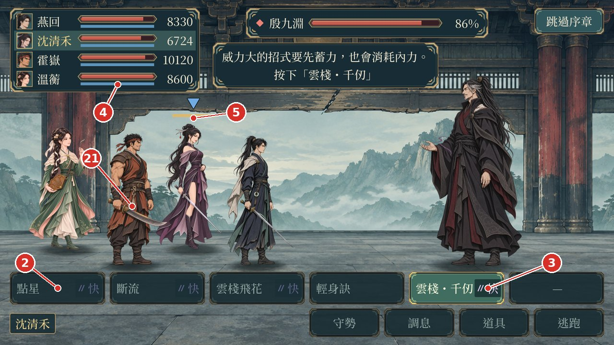
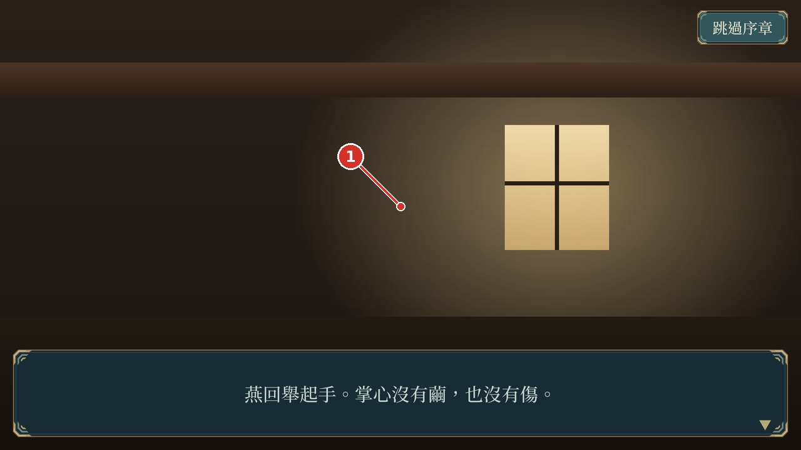
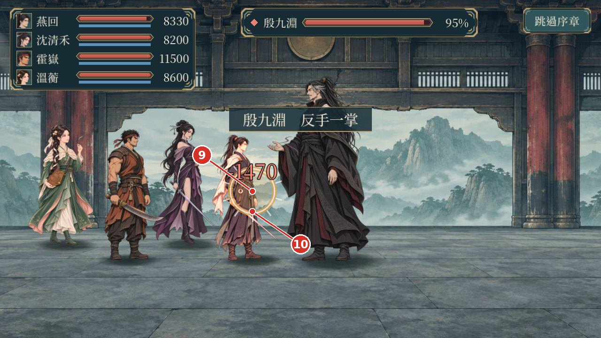
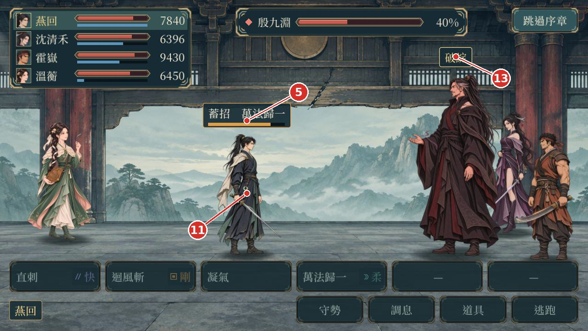
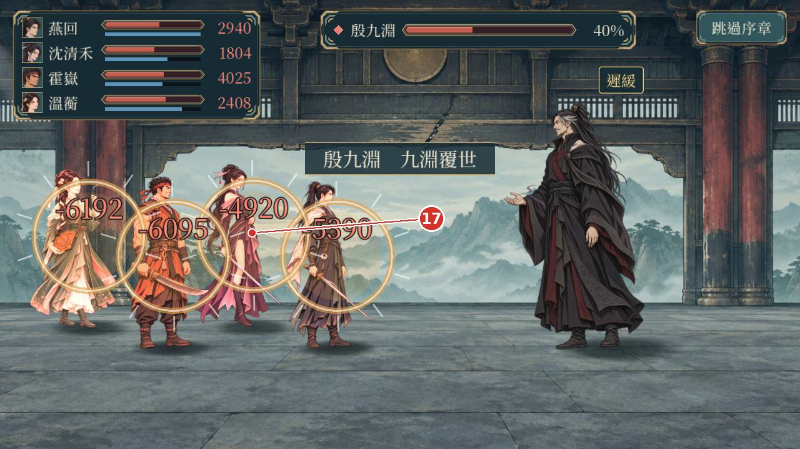
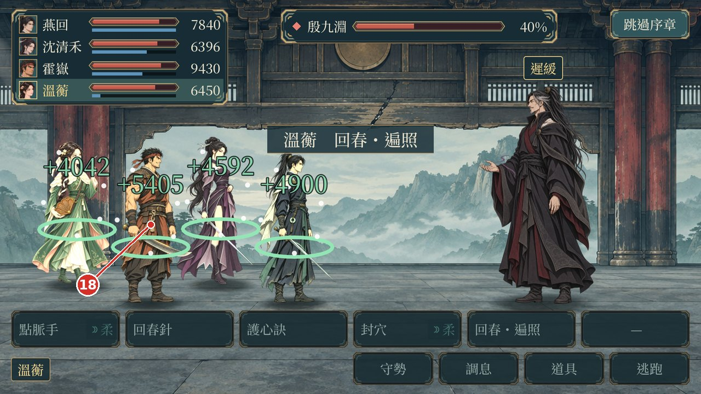
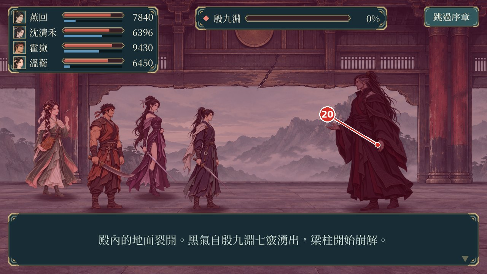

# 美術補畫需求單：序章的戰鬥畫面與特效

第 1 版（2026-11-26）｜提出：Claude（程式）｜對象：GPT（美術）｜擁有者指示：戰鬥畫面與特效缺的部分由 GPT 補畫

> **2026-11-27 擁有者最新指示：** 先補角色戰鬥動作；取消六個介面小圖示，剛／柔／快與狀態用文字辨識；所有素材直接提交本倉庫。沈清禾三段 Godot AnimationPlayer 試做與 7 個介面素材已交至 [batch_01](../assets/incoming/batch_01/README.md)，待接入驗收。以下清單已扣除取消的圖示。

批次 0 的立繪、天魔殿、介面樣張已經接進序章，可以從頭玩到尾。這份文件列出**序章的戰鬥畫面上，現在還是程式暫代、需要補畫的每一樣東西**：它在畫面的哪裡、現在長什麼樣子、要畫成什麼、檔名與尺寸。

讀完這一份就可以開工，不必再翻其他文件。想看規格的來由，見[設計文件第 15 章](design.md#15-gpt-負責的工作)；畫風以[風格指南](../assets/style/guide.md)為準。

## 1. 總覽

一共 57 個檔，分四類。每一項在下面的遊戲截圖上都有一個紅色編號。

| 類別 | 編號 | 件數 | 現在是什麼在頂替 | 先後 |
| --- | --- | --- | --- | --- |
| 背景 | 1 | 1 張 | 漸層色塊 | **第一優先** |
| 介面 | 2、4、5 | 7 個檔 | 把同一張按鈕調亮調暗、純色的條 | **第一優先** |
| 特效 | 7–20 | 14 組 | 程式畫的光痕、圓圈、光環 | **第一優先** |
| 角色動作 | 21 | 35 條，約 183 格 | 每個人只有一張站姿，在畫面上位移與傾斜 | 第二優先，先試做 |

第一優先的三類彼此獨立，也不必等角色動作，現在就能畫。角色動作數量最大、也最容易出問題（同一個角色忽大忽小），所以先用一個角色的三個動作試做，確認接得上再量產。

## 2. 所有檔案共通的規則

- **去背的圖**（介面、圖示、角色）：PNG，背景必須是真的透明。不要把灰白棋盤格畫進圖裡。
- **特效**：可以用純黑底（`#000000`），我用加亮的方式疊上去，黑色會自動消失；也可以用透明底。
- 圖裡不要有文字、簽名、浮水印、邊框、格線、編號。
- 角色與特效一律**朝右**（出手的人在左，往右打）。敵方由程式左右翻轉。
- 光源來自左上。不要畫地上的影子，影子由程式加。
- 尺寸可以比規格大，只要比例相同；不可以小。
- 檔名只用英文小寫、數字、底線，並且**照表裡的檔名**，我是用檔名接進遊戲的。
- **交付位置**：`assets/incoming/batch_01/` 底下，路徑照表裡寫的。例如表裡的 `vfx/slash_sword.png`，就放在 `assets/incoming/batch_01/vfx/slash_sword.png`。
- 可以分次交，不必等全部畫完。先交的我先接。

## 3. 背景與介面（編號 1、2、4、5）

*圖 1　輪到沈清禾、等玩家按招式的畫面。*

*圖 12　序章的最後一個場景：燕回在青石鎮的舊居醒來。*

| 編號 | 要畫的 | 檔名 | 規格 | 現在的樣子 | 畫面要求 |
| --- | --- | --- | --- | --- | --- |
| 1 | 青石鎮舊居的背景 | `backgrounds/battle/old_house.jpg` | 2560×1080，JPG 或 PNG | 圖 12：漸層色塊加一個發亮的窗 | 清晨，簡陋的民居室內。劇本寫的是「雞鳴。一根熟悉的屋樑。青石鎮，舊居。」所以要看得到屋樑，窗外有剛亮的天光。沒有人物。構圖規則和天魔殿相同：畫面下方三分之一是平整的地面，重要的東西放在中央 1920 像素寬以內。這是整個序章最後停留的畫面，氣氛要和天魔殿的肅殺成對比：安靜、樸素、微暖 |
| 2 | 按鈕的另外三種狀態 | `ui/button_disabled.png`、`ui/button_pressed.png`、`ui/button_active.png` | 各 320×128，和現有的 `ui/button.png` 同尺寸、同樣是九宮格（四邊各 28 像素不拉伸） | 圖 1：暗的那些按鈕是把同一張圖調暗，亮的那一個是調亮並閃爍 | 停用：整體壓暗、降低彩度，一眼看得出不能按。按下：比一般狀態略暗、有壓下去的感覺。可按（active）：輪到玩家、現在該按的那一個，邊框的舊銅色亮起來。三張的外形、邊框粗細要和 `ui/button.png` 完全一致，只改明暗與顏色 |
| 4 | 內力條 | `ui/mp_track.png`（底槽）、`ui/mp_fill.png`（填充） | 各 384×20 | 圖 1：氣血條下面那條細細的藍色，是純色 | 做法和現有的氣血條一樣：底槽與填充同尺寸、左上對齊；左右各 20 像素是不拉伸的端頭，中段會被拉長；填充離底槽左右兩端各 10 像素。顏色我暫用 `#5F93B8`，風格指南沒有定內力的顏色，請一併決定，要和氣血的朱紅、我方記號的藍分得開 |
| 5 | 行動條、蓄招倒數條 | `ui/gauge_track.png`、`ui/gauge_fill.png` | 各 384×20 | 圖 1：沈清禾頭上那條黃色；圖 4：「蓄招　九淵覆世」底下那條 | 做法同上。顏色我暫用 `#D9B872`。兩種條共用這一組圖 |

## 4. 特效（編號 7–20）

### 4.1 特效的畫法

- **一組特效是一張橫排的圖**：格子由左到右就是播放順序，每格等寬，格與格之間不留間距、不畫線。
- 共用特效每格 512×512，6–10 格。絕招每格 1024×1024，8–12 格。
- 圖裡**只畫特效，不要畫人**。
- **對位有兩種：**
  - 打在對手身上的（劍光、刀光、掌勁、受擊火花、絕招的命中）：命中點在格子的**正中**。
  - 套在自己身上的（蓄招氣場、守勢、破綻標記、萬魔歸墟）：想像一個 400 像素高的人站在格子正中，腳底在離格子底邊 32 像素的線上（和角色的格子同一套對位），特效畫在他身上、腳下或頭上。
- **共用特效請畫成白色到淺灰，不要上色。** 程式會依招式的勁路把它染成剛（琥珀）、柔（青綠）、快（淡紫）。絕招是某一招專用的，可以自己帶顏色。
- 標了「循環」的，最後一格要能接回第一格。
- 命中的瞬間請放在第 3 格前後。想指定是哪一格，寫在 `vfx/meta.json`：`{ "slash_sword": { "impact_frame": 3 } }`。

*圖 2　燕回「直刺」命中殷九淵。*

*圖 3　殷九淵「反手一掌」打中燕回。*

*圖 4　殷九淵蓄「九淵覆世」。*

*圖 5　全隊守勢。*

*圖 9　殷九淵被架住、露出破綻；燕回蓄「萬法歸一」。*

### 4.2 共用特效（7 組，每格 512×512）

| 編號 | 特效 | 檔名 | 格數 | 序章裡用在哪 | 現在的樣子 | 畫面要求 |
| --- | --- | --- | --- | --- | --- | --- |
| 7 | 劍光 | `vfx/slash_sword.png` | 6–10 | 燕回「直刺」、沈清禾「點星」，以及沈清禾搶上去架住殷九淵 | 圖 2：一道兩頭尖的斜線 | 一道細而銳利的劍痕，由左上劃向右下，先亮後收，留一點殘光 |
| 8 | 刀光 | `vfx/slash_blade.png` | 6–10 | 霍嶽「橫斬」，以及霍嶽搶上去架住殷九淵 | 和圖 2 同一種斜線 | 比劍光寬厚的弧形刀痕，橫掃，尾端帶碎屑感。要和劍光一眼分得出來 |
| 9 | 掌勁 | `vfx/palm.png` | 6–10 | 殷九淵「反手一掌」「袖風」「震開」；燕回雙掌把同伴震出殿外 | 圖 3：一個向外擴散的圓圈 | 一團向前推出的氣勁，擊中後向外震開一圈 |
| 10 | 受擊火花 | `vfx/hit_spark.png` | 4–6 | 每一次有人挨打 | 圖 2、圖 3：只有挨打的人身體閃紅，沒有火花 | 短促的迸裂：幾道碎光或氣屑向外飛散，很快消失 |
| 11 | 蓄招氣場（循環） | `vfx/charge_aura.png` | 6–10 | 所有需要蓄力的招式，蓄力期間一直播 | 圖 4、圖 9：蓄招的人只是忽明忽暗 | 氣流從腳下升起、繞著身體旋上去 |
| 12 | 守勢（循環） | `vfx/guard.png` | 4–8 | 玩家按下「守勢」後，四個人身上 | 圖 5：身體變成偏藍 | 身前一層半透明的護體氣罩，微微流動 |
| 13 | 破綻標記（循環） | `vfx/stagger_mark.png` | 4–8 | 殷九淵被架住、門戶大開的時候 | 圖 9：頭上只有「破綻」兩個字 | 胸前或頭頂一個醒目的記號，例如裂開並閃動的圓環，告訴玩家「現在打最痛」 |

### 4.3 絕招特效（7 組，每格 1024×1024）

*圖 7　沈清禾「雲棧・千仞」命中。斷岳、封穴目前也是類似的暫用畫面。*

*圖 6　殷九淵「九淵覆世」打中全隊。*

*圖 8　溫蘅「回春・遍照」治療全隊。*

*圖 10　燕回「萬法歸一」，最後一擊。畫面的白光是程式做的，會保留。*

*圖 11　殷九淵發動「萬魔歸墟」，大殿崩解。*

| 編號 | 絕招 | 檔名 | 格數 | 誰對誰 | 現在的樣子 | 畫面要求 |
| --- | --- | --- | --- | --- | --- | --- |
| 14 | 雲棧・千仞 | `vfx/shen_qianren.png` | 8–12 | 沈清禾 → 殷九淵 | 圖 7：交叉的兩道光痕 | 華山快劍：極快的多道劍光疊成一片，像千道山稜。淡紫色調 |
| 15 | 斷岳 | `vfx/huo_duanyue.png` | 8–12 | 霍嶽 → 殷九淵 | 同圖 7 | 一刀由上而下的厚重刀勢，落點地面迸裂。琥珀色調 |
| 16 | 封穴 | `vfx/wen_fengxue.png` | 8–12 | 溫蘅 → 殷九淵（之後他進入遲緩） | 同圖 3 的圓圈 | 幾枚細針的光點依序命中，經脈被封住的紋路亮起又暗下。青綠色調 |
| 17 | 九淵覆世 | `vfx/tianmo_fushi.png` | 8–12 | 殷九淵 → 我方四人 | 圖 6：四個人身上各一個圓圈 | 黑紫色的氣勁像潮水一樣橫掃過去。**照慣例畫成由左往右**，程式會翻轉。四個人站成約 900 像素寬的一排，一張圖要蓋得住全部；格子正中是四人的正中、胸口的高度 |
| 18 | 回春・遍照 | `vfx/wen_bianzhao.png` | 8–12 | 溫蘅 → 我方四人 | 圖 8：每人身上三圈上升的綠色光環 | 柔和的青綠光自地面升起，帶花瓣或光點。同樣要蓋住四個人，對位同上 |
| 19 | 萬法歸一 | `vfx/yanhui_wanfa.png` | 8–12 | 燕回 → 殷九淵，最後一擊 | 圖 10：交叉的兩道光痕 | 所有的光匯聚成一劍貫穿過去，整個序章最亮的一擊。靛青與練白 |
| 20 | 萬魔歸墟（循環） | `vfx/tianmo_guixu.png` | 8–12 | 殷九淵自身，持續好幾句對話 | 圖 11：整個畫面泛紅、震動，殷九淵身上沒有任何東西 | 黑氣自他身上湧出、向四周翻湧。以他為中心：想像一個 590 像素高的人站在格子正中、腳底離格子底邊 64 像素 |

## 5. 角色動作（編號 21）

**現在的樣子。** 圖 1、圖 2 裡每個人都只有一張站姿。出手是整張圖往前衝，受擊是往後仰加閃紅，殷九淵「單膝跪地」只是整張圖前傾變暗。

**要畫的。** 序章實際用到的動作一共 35 條、約 183 格，完整清單在最後的附錄（「角色動作」那一段）。比每人全套 12 個動作少，因為序章用不到的（例如勝利）先不畫。

**規格**

- 一個動作一張橫排圖，格子由左到右是播放順序，每格等寬，不留間距、不畫線。檔名 `characters/{識別碼}/frames/{動作}.png`。
- 四位主角每格 512×512，殷九淵每格 768×768。可以畫成兩倍大（1024、1536），只要是正方形。
- 腳底踩在離格子底邊 32 像素的線上（兩倍大的圖是 64），雙腳的中點在格子的水平正中。
- 站立時的高度（以 512 與 768 的格子計）：燕回 400、沈清禾 392、霍嶽 412、溫蘅 382、殷九淵 590。
- **同一個角色的每一格、每一個動作，人都要一樣大。** 這是最容易出錯、我也修不了的地方。
- **對位與大小的基準**是現在遊戲裡用的站姿圖 `assets/characters/{識別碼}/frames/stand.png`，它已經照上面的規則擺好。請拿它當第一格的底，別的格子都對著它畫。
- 只畫原地的動作。衝到對手面前、打完退回，由程式移動。
- 兵器畫在角色身上。畫法、配色、配件要和設定圖一致。
- 出手的動作請標明哪一格是「打到」的瞬間，寫在 `characters/{識別碼}/frames/meta.json`：`{ "attack_light": { "impact_frame": 3 } }`。沒標的話我用整段的六成。

**先後**

1. **先試做**：全盛沈清禾（`shen_peak`）的 `idle`、`attack_light`、`hit` 三條，共 15 格。交給我接進遊戲，確認大小、對位、播放都對。
2. 試做通過後，建議的順序：殷九淵（他挨打最多，受擊、破綻、倒下最需要）→ 燕回 → 霍嶽 → 溫蘅。
3. **來不及的話**：每個動作先交 1 格，畫最有代表性的那一瞬間，檔名不變（就是只有一格的橫排圖）。至少出手、受擊、倒下不會是同一張圖，之後再補成完整的逐格。

設計文件另外準備了拆件加骨骼的做法（[15.6](design.md#156-戰鬥動畫怎麼交付) 的乙），想試的話和逐格圖擇一即可；逐格圖是保底方案。

## 6. 這次不必畫的

下面這些畫面上有，但不急，留到後面的批次：

- 招式名與「大招警示」的橫幅底（圖 2、圖 4 中央那一條），目前是深色底加兩條細線，可以沿用。
- 選目標時腳下的圈與頭上的箭頭，目前是程式畫的。
- 守勢、調息、道具、逃跑四個指令的圖示，目前按鈕上只有文字。
- 對話框的頭像，目前是我從臉部特寫裁出來的；五種表情的對話立繪排在之後。
- 序章的五張劇情圖、招式圖示、標題畫面。

## 7. 交付之後

1. 檔案放進 `assets/incoming/batch_01/`（推到倉庫，或請擁有者傳給我）。
2. 我檢查檔名、尺寸、透明、每格的大小是否一致，結果寫進設計文件 15.14。
3. 通過的移到正式資料夾、接進遊戲，然後錄影給擁有者看。不通過的，我列出是哪個檔、哪裡不合。

**我這邊還沒做的。** 逐格圖的播放（角色動作與特效）程式還沒寫，現在遊戲只會用站姿與程式畫的效果；第一批圖到了我就寫，不需要 GPT 配合。按鈕狀態、內力條、行動條、圖示接起來很快，同樣是我這邊的工作。

想知道還缺什麼，在專案根目錄執行 `python3 tools/art_needs.py --missing`；清單是從劇本與招式資料算出來的，劇本改了它會跟著變。

## 附錄：完整檔案清單

由 `tools/art_needs.py` 於 2026-11-27 重建；小圖示已取消，7 個介面素材與沈清禾三段動畫列為待驗收。

### 背景

| 檔案 | 規格 | 用在哪裡 | 狀態 |
| --- | --- | --- | --- |
| `backgrounds/battle/tianmo_hall.jpg` | 2560×1080 | 開場 | 有 |
| `backgrounds/battle/old_house.jpg` | 2560×1080 | 中途換場景 | 缺 |

### 角色動作（共 35 條、約 183 格）

| 檔案 | 規格 | 用在哪裡 | 狀態 |
| --- | --- | --- | --- |
| `characters/yanhui_peak/frames/idle.png` | 6 格，每格 512×512，循環 | 燕回・待機：一直都在 | 缺 |
| `characters/yanhui_peak/frames/ready.png` | 4 格，每格 512×512，循環 | 燕回・準備出手：輪到自己、等玩家選招 | 缺 |
| `characters/yanhui_peak/frames/charge.png` | 6 格，每格 512×512，循環 | 燕回・蓄招：燕回「萬法歸一」 | 缺 |
| `characters/yanhui_peak/frames/attack_light.png` | 6 格，每格 512×512 | 燕回・快招：燕回「直刺」 | 缺 |
| `characters/yanhui_peak/frames/attack_heavy.png` | 8 格，每格 512×512 | 燕回・重招：燕回「萬法歸一」；雙掌把同伴震出殿外 | 缺 |
| `characters/yanhui_peak/frames/hit.png` | 3 格，每格 512×512 | 燕回・受擊：被殷九淵「反手一掌」打中；被殷九淵「九淵覆世」打中 | 缺 |
| `characters/yanhui_peak/frames/guard.png` | 3 格，每格 512×512，循環 | 燕回・守勢：全隊守勢 | 缺 |
| `characters/yanhui_peak/frames/walk.png` | 8 格，每格 512×512，循環 | 燕回・行走：走向對手 | 缺 |
| `characters/shen_peak/frames/idle.png` | 6 格，每格 512×512，循環 | 沈清禾・待機：一直都在 | 待驗收 |
| `characters/shen_peak/frames/ready.png` | 4 格，每格 512×512，循環 | 沈清禾・準備出手：輪到自己、等玩家選招 | 缺 |
| `characters/shen_peak/frames/charge.png` | 6 格，每格 512×512，循環 | 沈清禾・蓄招：沈清禾「雲棧・千仞」 | 缺 |
| `characters/shen_peak/frames/attack_light.png` | 6 格，每格 512×512 | 沈清禾・快招：沈清禾「點星」；搶上去架住對手 | 待驗收 |
| `characters/shen_peak/frames/attack_heavy.png` | 8 格，每格 512×512 | 沈清禾・重招：沈清禾「雲棧・千仞」 | 缺 |
| `characters/shen_peak/frames/hit.png` | 3 格，每格 512×512 | 沈清禾・受擊：被殷九淵「袖風」打中；被殷九淵「九淵覆世」打中；被震出殿外 | 待驗收 |
| `characters/shen_peak/frames/guard.png` | 3 格，每格 512×512，循環 | 沈清禾・守勢：全隊守勢 | 缺 |
| `characters/huo_peak/frames/idle.png` | 6 格，每格 512×512，循環 | 霍嶽・待機：一直都在 | 缺 |
| `characters/huo_peak/frames/ready.png` | 4 格，每格 512×512，循環 | 霍嶽・準備出手：輪到自己、等玩家選招 | 缺 |
| `characters/huo_peak/frames/charge.png` | 6 格，每格 512×512，循環 | 霍嶽・蓄招：霍嶽「斷岳」 | 缺 |
| `characters/huo_peak/frames/attack_light.png` | 6 格，每格 512×512 | 霍嶽・快招：霍嶽「橫斬」；搶上去架住對手 | 缺 |
| `characters/huo_peak/frames/attack_heavy.png` | 8 格，每格 512×512 | 霍嶽・重招：霍嶽「斷岳」 | 缺 |
| `characters/huo_peak/frames/hit.png` | 3 格，每格 512×512 | 霍嶽・受擊：被殷九淵「震開」打中；被殷九淵「九淵覆世」打中；被震出殿外 | 缺 |
| `characters/huo_peak/frames/guard.png` | 3 格，每格 512×512，循環 | 霍嶽・守勢：全隊守勢 | 缺 |
| `characters/wen_peak/frames/idle.png` | 6 格，每格 512×512，循環 | 溫蘅・待機：一直都在 | 缺 |
| `characters/wen_peak/frames/ready.png` | 4 格，每格 512×512，循環 | 溫蘅・準備出手：輪到自己、等玩家選招 | 缺 |
| `characters/wen_peak/frames/charge.png` | 6 格，每格 512×512，循環 | 溫蘅・蓄招：溫蘅「封穴」；溫蘅「回春・遍照」 | 缺 |
| `characters/wen_peak/frames/cast.png` | 6 格，每格 512×512 | 溫蘅・施法：溫蘅「封穴」；溫蘅「回春・遍照」 | 缺 |
| `characters/wen_peak/frames/hit.png` | 3 格，每格 512×512 | 溫蘅・受擊：被殷九淵「九淵覆世」打中；被震出殿外 | 缺 |
| `characters/wen_peak/frames/guard.png` | 3 格，每格 512×512，循環 | 溫蘅・守勢：全隊守勢 | 缺 |
| `characters/tianmo/frames/idle.png` | 6 格，每格 768×768，循環 | 殷九淵・待機：一直都在 | 缺 |
| `characters/tianmo/frames/charge.png` | 6 格，每格 768×768，循環 | 殷九淵・蓄招：殷九淵「九淵覆世」 | 缺 |
| `characters/tianmo/frames/attack_light.png` | 6 格，每格 768×768 | 殷九淵・快招：殷九淵「反手一掌」；殷九淵「袖風」；殷九淵「震開」 | 缺 |
| `characters/tianmo/frames/attack_heavy.png` | 8 格，每格 768×768 | 殷九淵・重招：殷九淵「九淵覆世」 | 缺 |
| `characters/tianmo/frames/hit.png` | 3 格，每格 768×768 | 殷九淵・受擊：被燕回「直刺」打中；被沈清禾「點星」打中；被霍嶽「橫斬」打中… | 缺 |
| `characters/tianmo/frames/stagger.png` | 4 格，每格 768×768，循環 | 殷九淵・破綻：被架住、露出破綻 | 缺 |
| `characters/tianmo/frames/down.png` | 6 格，每格 768×768 | 殷九淵・倒下：被燕回「萬法歸一」打中 | 缺 |

### 特效

| 檔案 | 規格 | 用在哪裡 | 狀態 |
| --- | --- | --- | --- |
| `vfx/slash_sword.png` | 6–10 格，每格 512×512 | 劍光：燕回「直刺」；沈清禾「點星」 | 缺 |
| `vfx/slash_blade.png` | 6–10 格，每格 512×512 | 刀光：霍嶽「橫斬」 | 缺 |
| `vfx/palm.png` | 6–10 格，每格 512×512 | 掌勁：殷九淵「反手一掌」；殷九淵「袖風」；殷九淵「震開」… | 缺 |
| `vfx/hit_spark.png` | 4–6 格，每格 512×512 | 受擊火花：殷九淵被燕回「直刺」打中；燕回被殷九淵「反手一掌」打中；殷九淵被沈清禾「點星」打中… | 缺 |
| `vfx/charge_aura.png` | 6–10 格，每格 512×512，循環 | 蓄招氣場（循環）：沈清禾「雲棧・千仞」；霍嶽「斷岳」；溫蘅「封穴」… | 缺 |
| `vfx/guard.png` | 4–8 格，每格 512×512，循環 | 守勢：全隊守勢 | 缺 |
| `vfx/stagger_mark.png` | 4–8 格，每格 512×512，循環 | 破綻標記：殷九淵露出破綻 | 缺 |
| `vfx/huo_duanyue.png` | 8–12 格，每格 1024×1024 | 絕招「斷岳」：霍嶽「斷岳」 | 缺 |
| `vfx/shen_qianren.png` | 8–12 格，每格 1024×1024 | 絕招「雲棧・千仞」：沈清禾「雲棧・千仞」 | 缺 |
| `vfx/tianmo_fushi.png` | 8–12 格，每格 1024×1024 | 絕招「九淵覆世」：殷九淵「九淵覆世」 | 缺 |
| `vfx/tianmo_guixu.png` | 8–12 格，每格 1024×1024，循環 | 絕招「萬魔歸墟」：殷九淵發動「萬魔歸墟」，大殿崩解 | 缺 |
| `vfx/wen_bianzhao.png` | 8–12 格，每格 1024×1024 | 絕招「回春・遍照」：溫蘅「回春・遍照」 | 缺 |
| `vfx/wen_fengxue.png` | 8–12 格，每格 1024×1024 | 絕招「封穴」：溫蘅「封穴」 | 缺 |
| `vfx/yanhui_wanfa.png` | 8–12 格，每格 1024×1024 | 絕招「萬法歸一」：燕回「萬法歸一」 | 缺 |

### 介面

| 檔案 | 規格 | 用在哪裡 | 狀態 |
| --- | --- | --- | --- |
| `ui/button_disabled.png` | 320×128，九宮格，四邊各 28 | 按鈕的停用狀態：還沒輪到、不能按的招式與指令 | 待驗收 |
| `ui/button_pressed.png` | 320×128，九宮格，四邊各 28 | 按鈕按下去的那一瞬間 | 待驗收 |
| `ui/button_active.png` | 320×128，九宮格，四邊各 28 | 現在可以按的那一個按鈕（目前是把一般狀態調亮並閃爍） | 待驗收 |
| `ui/mp_track.png` | 384×20，左右各 20 是不拉伸的端頭 | 內力條的底槽 | 待驗收 |
| `ui/mp_fill.png` | 384×20，左右各 20 是不拉伸的端頭 | 內力條的填充 | 待驗收 |
| `ui/gauge_track.png` | 384×20，左右各 20 是不拉伸的端頭 | 行動條與蓄招倒數條的底槽 | 待驗收 |
| `ui/gauge_fill.png` | 384×20，左右各 20 是不拉伸的端頭 | 行動條與蓄招倒數條的填充 | 待驗收 |

合計：有 1，待驗收 10，缺 47。

